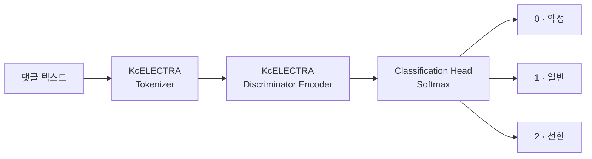
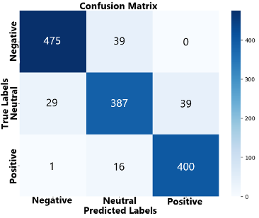
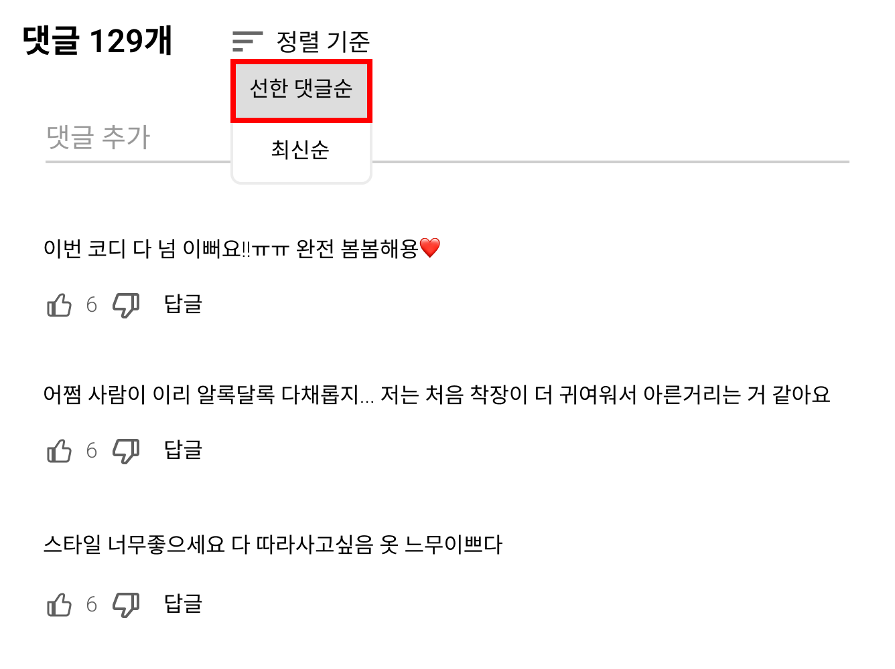

# 선한 댓글 우선 노출을 위한 ELECTRA 기반 다중 클래스 댓글 분류

**Multi-class Comment Classification with KcELECTRA for Prioritizing Positive Comments**

> 성결대학교 컴퓨터공학과 · 이준행, 박상우, 오현영


---

## 📌 Overview

악성 댓글을 **탐지해서 막는 것**만으로는 한계가 있습니다. 작성 방식이 교묘해질수록 탐지에 실패하는 댓글이 생기고, 그 댓글은 그대로 사용자에게 노출됩니다.

이 프로젝트는 관점을 바꿔 **선한 댓글을 찾아 먼저 보여주는** 방식을 제안합니다.

1. **KcELECTRA를 3-클래스 분류기로 파인튜닝**해 댓글을 `악성 / 일반 / 선한` 으로 분류합니다.
2. 분류 결과로 **"선한 댓글순" 정렬**을 제공해, 탐지되지 않은 악성 댓글이 노출될 가능성을 줄입니다.

| Accuracy | Precision | Recall | F1-score |
| :--: | :--: | :--: | :--: |
| **91.05%** | **90.91%** | **91.13%** | **90.99%** |

<sub>Precision, Recall, F1은 세 클래스의 macro 평균입니다.</sub>

---

## 🧩 Motivation

- 온라인 플랫폼이 커지면서 댓글로 의견을 나누는 일이 늘었지만, **악성 댓글로 인한 정신적 피해와 사회적 부작용**도 함께 늘고 있습니다.
- 혐오 콘텐츠에 반복적으로 노출되면 심리적 불안, 집단 간 불신, 편견 강화로 이어질 수 있으며, 익명성은 이를 더 빠르게 퍼뜨립니다.
- 주요 플랫폼이 AI 기반 악성 댓글 탐지를 도입했지만, 우회 표현이 늘면서 **탐지에 실패하는 경우가 생깁니다.** 기존 정렬 방식(인기순, 최신순)에서는 그런 댓글이 그대로 노출됩니다.

→ 악성 댓글만 걸러내는 대신 **선한 댓글을 인식해서 먼저 노출**하는 접근이 필요합니다.

---

## 🗂 Dataset

두 출처에서 데이터를 모아 총 **6,928개**의 3-클래스 데이터셋을 만들었습니다.

| 클래스 | 라벨 | 개수 | 출처 |
| :-- | :--: | --: | :-- |
| 악성 댓글 | 0 | 2,472 | [Korean UnSmile Dataset](https://github.com/smilegate-ai/korean_unsmile_dataset) 혐오 표현을 균형 있게 선정해 하나의 클래스로 통합 |
| 일반 댓글 | 1 | 2,413 | YouTube 댓글 |
| 선한 댓글 | 2 | 2,043 | YouTube 댓글 |
| **합계** | | **6,928** | |

- YouTube 댓글은 뉴스, 예능, 스포츠 등 여러 카테고리의 영상에서 **14,772개**를 수집했습니다. 전처리와 라벨링을 거쳐 일반 댓글과 선한 댓글을 골라냈습니다.
- 댓글 수집과 전처리 과정은 [YouTube 댓글 텍스트 마이닝](docs/text-mining-youtube-comments.md) 문서에 정리되어 있습니다.

---

## 🧠 Model

**[KcELECTRA](https://github.com/Beomi/KcELECTRA)** 를 3-클래스 문장 분류기로 파인튜닝했습니다. KcELECTRA는 네이버 뉴스 댓글 같은 구어체 텍스트로 사전학습된 한국어 ELECTRA 모델이라, 신조어, 오타, 줄임말이 많은 댓글 데이터에 잘 맞습니다.



### 왜 ELECTRA인가
- BERT의 **MLM(Masked Language Modeling)** 은 마스킹된 일부 토큰(약 15%)에서만 학습하므로 데이터를 비효율적으로 씁니다.
- ELECTRA는 **RTD(Replaced Token Detection)** 로 학습합니다. 작은 Generator가 일부 토큰을 그럴듯한 다른 토큰으로 바꾸고, Discriminator가 **모든 토큰**에 대해 원본인지 교체된 것인지 판별합니다.
- 모든 토큰에서 학습 신호를 얻기 때문에 **적은 데이터로도 문맥을 효과적으로 학습**할 수 있습니다.

---

## 📊 Results

### 혼동행렬 (Test set, n = 1,386)

<p align="center">
  
</p>

| 클래스 | Precision | Recall | F1-score | Support |
| :-- | :--: | :--: | :--: | --: |
| 악성 (Negative) | 0.941 | 0.924 | 0.932 | 514 |
| 일반 (Neutral) | 0.876 | 0.851 | 0.863 | 455 |
| 선한 (Positive) | 0.911 | 0.959 | 0.935 | 417 |
| **Macro avg** | **0.909** | **0.911** | **0.910** | 1,386 |

<sub>클래스별 지표는 혼동행렬에서 계산했습니다.</sub>

- **악성 댓글과 선한 댓글은 높은 정확도로 분류**했습니다.
- 악성 댓글이 선한 댓글로 잘못 분류된 경우는 **0건**이고, 선한 댓글이 악성으로 분류된 경우도 **1건**뿐입니다. 선한 댓글순 정렬에 악성 댓글이 섞여 들어갈 위험이 매우 낮다는 뜻입니다.
- 오분류는 주로 **일반(중립) 댓글**과 다른 클래스 사이에서 생겼습니다.

### 예측 사례

| 구분 | 댓글 | 실제 | 예측 | P(악성) | P(일반) | P(선한) |
| :-- | :-- | :--: | :--: | :--: | :--: | :--: |
| ✅ 성공 | 젠신병자는 뒤져야된다 이기야 | 0 | 0 | **0.993** | 0.005 | 0.001 |
| ✅ 성공 | 요즘은 석유난로 거의 안쓰니 다들 환기시켜야되는거 생각도 못했나보네 | 1 | 1 | 0.002 | 0.028 | 0.969 |
| ✅ 성공 | 앞으로도 맛있는요리 꿀팁 많이 가르쳐주십시요 감사합니다 | 2 | 2 | 0.002 | 0.023 | **0.974** |
| ❌ 실패 | 아니 얼마나 살이 쪘으면 저리 돼지냐 | 0 | 1 | 0.375 | **0.616** | 0.007 |
| ❌ 실패 | 울 신랑이 보배회원이라 가끔 곁다리로 보는데 아재들 화력 짱 | 1 | 0 | **0.833** | 0.160 | 0.006 |
| ❌ 실패 | 천사분들이 여기 계셨네요 | 2 | 1 | 0.016 | **0.570** | 0.412 |

> ⚠️ 원본 포스터 표의 값을 그대로 옮겼습니다. 두 번째 성공 사례는 예측이 "일반(1)"인데 확률은 "선한" 열이 0.969로 가장 높아서, 표의 확률 열 순서나 값을 원본에서 한 번 확인해 볼 필요가 있습니다.

**오분류 분석**: "얼마나 살이 쪘으면 저리 돼지냐"처럼 비하 표현이 들어간 문장을 일반 댓글로 분류했습니다. 직접적인 욕설 없이 **특정 단어를 문맥에 맞게 해석해야 하는 경우**에 약하다는 뜻이며, 이런 사례를 보강한 데이터가 필요합니다.

---

## 💡 Application: 선한 댓글순 정렬

<p align="center">
  
</p>

- 기존 **인기순, 최신순** 정렬에 **"선한 댓글순"** 옵션을 추가합니다.
- 모델이 선한 댓글로 분류한 댓글을 먼저 보여주므로, 탐지되지 않은 악성 댓글이 상단에 노출될 가능성이 크게 줄어듭니다.
- 정렬 기준을 사용자가 직접 고를 수 있어 **사용자의 선택권**도 보장됩니다.

---

## ✅ Conclusion & Future Work

- 악성 댓글 필터링과 선한 댓글 우선 정렬을 함께 지원하는 **3-클래스 댓글 분류 모델**을 제안했습니다.
- KcELECTRA 파인튜닝으로 **정확도 91.05%, F1 90.99%** 를 달성했습니다.
- 다만 **중립적인 표현의 문맥 해석**에서 일부 오분류가 있었습니다.

**Future Work**
- 다양한 맥락을 담은 대규모 데이터셋으로 모델의 문맥 이해 능력 향상
- 우회적인 비하 표현과 중립 표현의 경계 사례 보강
- 선한 댓글 정렬 시스템의 정밀도 개선

---

## 📁 Repository Structure

```
.
├── README.md                              # 프로젝트 개요 (이 문서)
├── docs/
│   └── text-mining-youtube-comments.md    # YouTube 댓글 수집·전처리·통계 분석
└── assets/
    ├── confusion_matrix.png
    ├── good_comment_sort_ui.png
    └── text-mining/                       # 텍스트 마이닝 분석 그래프
```

---

## 👥 Team

| 이름 | 담당 |
| :-- | :-- |
| 이준행 | YouTube 댓글 수집, 텍스트 전처리, 단어 빈도 분석 |
| 박상우 | YouTube API 댓글 크롤러 구현, TF-IDF·코사인 유사도 분석, 데이터 라벨링 |
| 오현영 | 뉴스·댓글 크롤링 탐구, 전처리 구현, Zipf·Heaps 법칙 분석 |

---

## 📚 References

- K. Clark, M.-T. Luong, Q.V. Le, and C.D. Manning, "ELECTRA: Pre-Training Text Encoders as Discriminators Rather Than Generators," *ICLR*, 2020. [arXiv:2003.10555](https://arxiv.org/abs/2003.10555)
- J. Lee, "KcELECTRA: Korean comments ELECTRA," GitHub, 2021. [Beomi/KcELECTRA](https://github.com/Beomi/KcELECTRA)
- Smilegate AI, "Korean UnSmile Dataset," GitHub, 2022. [smilegate-ai/korean_unsmile_dataset](https://github.com/smilegate-ai/korean_unsmile_dataset)
