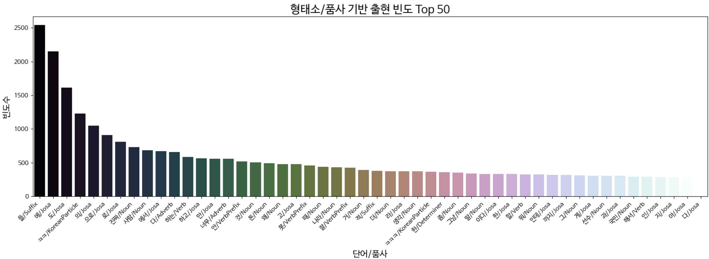
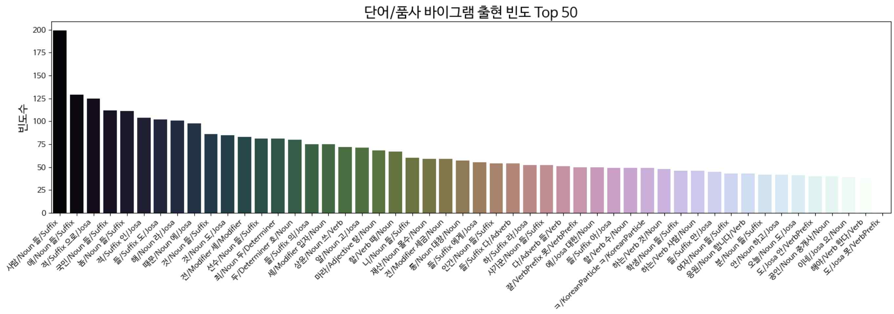
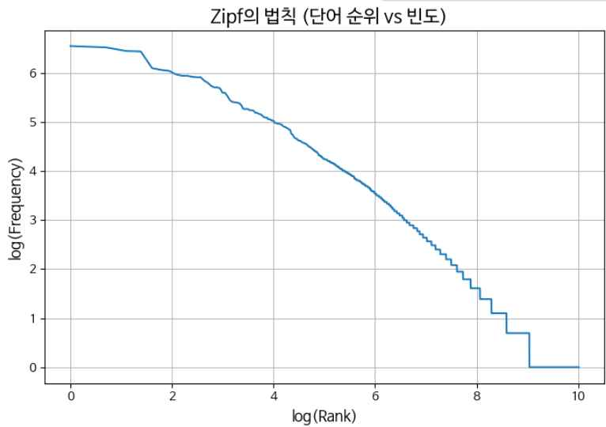
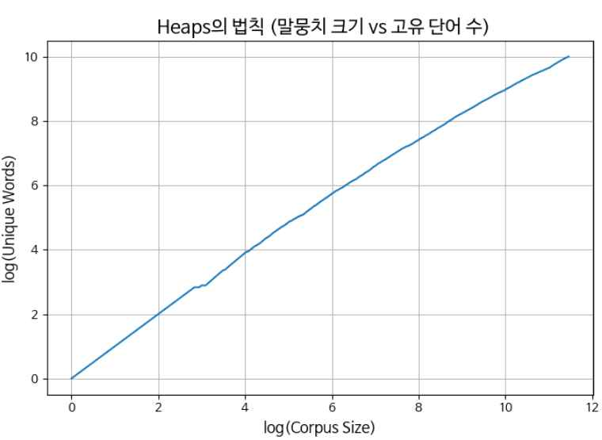

# YouTube 댓글 텍스트 마이닝

> 텍스트마이닝 과제 1 (2025.04) · 성결대학교 컴퓨터공학과 · 이준행, 박상우, 오현영

YouTube 영상 댓글을 직접 수집해 전처리하고, 단어 빈도, Zipf·Heaps 법칙, 댓글 간 유사도를 분석했습니다. 이 과정에서 만든 댓글 수집·정제 파이프라인은 [다중 클래스 댓글 분류 모델](../README.md)의 데이터 구축으로 이어졌습니다.

---

## 1. 개요

- **목표**: 실제 온라인 텍스트로 텍스트 마이닝 기법을 실습하고, 정제와 분석의 전 과정을 수행
- **분석 대상 선정 이유**: 악성 댓글로 인한 사회적 문제가 꾸준히 제기되고 있습니다. YouTube는 국내에서 가장 널리 쓰이는 영상 플랫폼으로, 댓글에 사용자의 솔직한 반응과 감정이 잘 드러나 분석에 적합합니다.

| 단계 | 내용 |
| :-- | :-- |
| 수집 | YouTube Data API v3, 7개 장르, 11,173개 댓글 |
| 정제 | 정규표현식, 이모지 제거, 반복 문자 정규화 → 10,523개 |
| 형태소 분석 | Mecab과 Okt 비교 후 **Okt** 채택 |
| 불용어 | 조사 6개(`은 는 이 가 을 를`)만 선택적으로 제거 |
| 분석 | 단어/품사 빈도, 바이그램, Zipf, Heaps, TF-IDF 유사도 |

---

## 2. 데이터 수집

- **환경**: Google Colab, YouTube Data API v3
- **방식**: 브라우저 개발자 도구로 영상의 `videoId`를 추출한 뒤 API로 댓글을 JSON 형식으로 받아옴
- **장르**: 게임, 먹방, 사이버렉카, 스포츠, 음악, 여행, 개그 (7개)
- **규모**: 한 영상에 댓글이 치우치지 않도록 **영상당 최대 200개**만 수집. 장르별 약 1,700개, 중복 제거 후 **총 11,173개**

API는 한 번에 최대 100개의 댓글만 반환하므로 `nextPageToken`으로 다음 페이지를 이어서 요청했습니다.

```python
api_obj = build('youtube', 'v3', developerKey=API_KEY)

video_id = 'VIDEO_ID'
max_comments = 200
comments_fetched = 0

response = api_obj.commentThreads().list(
    part='snippet', videoId=video_id, maxResults=100
).execute()

while response and comments_fetched < max_comments:
    for item in response['items']:
        comment = item['snippet']['topLevelComment']['snippet']['textDisplay']
        comments.add(comment)
        comments_fetched += 1
        if comments_fetched >= max_comments:
            break
    if comments_fetched < max_comments and 'nextPageToken' in response:
        response = api_obj.commentThreads().list(
            part='snippet', videoId=video_id,
            pageToken=response['nextPageToken'], maxResults=100
        ).execute()
    else:
        break
```

수집한 댓글은 `pandas`로 정리해 `.xlsx`로 저장했습니다.

> 💡 **배운 점**: 처음에는 댓글을 최대한 많이 모았지만, 특정 인물의 이름이 상위 빈도를 차지하는 등 데이터가 한 주제에 쏠렸습니다. 그래서 영상당 수집량을 제한하고 장르를 고르게 나눴습니다. 데이터는 양보다 **분석 목적에 맞는 구성**이 중요합니다.

---

## 3. 텍스트 전처리

### 3.1 정규표현식

YouTube 댓글에는 이모티콘, 반복 문자, 초성어, URL, 특수문자가 많습니다. 특히 `ㅋㅋ`, `ㅊㅋ`, `ㄱㄱ`처럼 **초성으로 감정을 표현**하는 경우가 많아, 한글 자모와 음절은 남기고 나머지만 제거했습니다.

```python
import re
import emoji
from soynlp.normalizer import repeat_normalize

pattern = re.compile(r'[^ ㄱ-ㅣ가-힣]+')

def clean(x):
    x = pattern.sub(' ', x)                       # 한글 자모·음절·공백만 남김
    x = emoji.replace_emoji(x, replace='')        # 정규식을 통과한 이모지 제거
    x = x.strip()
    x = repeat_normalize(x, num_repeats=2)        # ㅋㅋㅋㅋ → ㅋㅋ
    return x
```

정제 후 공백이나 이모티콘만 있던 댓글을 지워 **11,173개 → 10,523개**가 남았습니다.

### 3.2 형태소 분석: Mecab vs Okt

| 분석기 | `ㅁㅊ` 처리 결과 | 판단 |
| :-- | :-- | :-- |
| Mecab | `ㅁ`(NNG) + `ㅊ가는`(UNKNOWN)으로 쪼개짐 | 초성어 인식 실패 |
| **Okt** | `ㅁㅊ`(**KoreanParticle**) 하나로 인식 | 구어체와 인터넷 표현에 강함 |

구어체 댓글을 더 정확하게 분석하기 위해 **Okt**를 최종 채택했습니다.

### 3.3 불용어 제거

| 방식 | 예시 (`호텔을 왜간겨`) | 결과 |
| :-- | :-- | :-- |
| 품사 기반 제거 (Josa, Eomi, PreEomi, Suffix) | `호텔 왜 겨` | 구어체에서 의미가 손상됨 ❌ |
| **조사 6개만 제거** (`은 는 이 가 을 를`) | `호텔 왜 간 겨` | 의미를 유지하면서 간결해짐 ✅ |

```python
remove_particles = ['은', '는', '이', '가', '을', '를']
okt = Okt()

pos_list = okt.pos(comment)
cleaned = ' '.join(w for w, tag in pos_list if w not in remove_particles)
```

---

## 4. 단어 빈도 분석

### 4.1 단어/품사 출현 빈도 Top 50



- 조사, 감탄사, 동사, 명사가 높은 빈도를 보였습니다.
- 조사 6개를 이미 지웠는데도 **상위 50개 중 20개가 조사**였습니다. 구어체에서 조사가 그만큼 자주 쓰인다는 뜻입니다.
- `ㅋㅋ`, `ㅋㅋㅋ` 같은 KoreanParticle도 자주 등장하지만 의미 전달에는 크게 기여하지 않습니다.
- `들, 에, 도, 의, 으로, 로, 에서`, `아`, `다, 고, 그, 게, 까지, 인데, 해서` 등은 추가 불용어 후보입니다.

### 4.2 바이그램 출현 빈도 Top 50



- **명사 + 복수 접미사 `들`** 조합이 가장 많았습니다(`사람들`, `국민들`, `놈들`, `애들`). 댓글에서 특정 집단이나 대상을 가리키는 패턴입니다.
- `전세금`, `재산몰수`, `사기꾼들`, `중대장`, `공인중개사`처럼 **특정 사회·경제 이슈**와 관련된 조합도 자주 등장했습니다.

---

## 5. Zipf의 법칙

단어의 빈도 $f$는 순위 $r$에 반비례합니다.

$$f \propto \frac{1}{r}$$



로그-로그 스케일에서 완만하게 내려가는 곡선이 나타납니다. 상위 단어의 빈도는 매우 높고 하위로 갈수록 급격히 줄어드는, 전형적인 Zipf 분포입니다. → **Zipf의 법칙이 대체로 성립합니다.**

---

## 6. Heaps의 법칙

말뭉치가 커질수록 고유 단어 수 $V(n)$는 늘어나지만, 증가 속도는 점점 느려집니다.

$$V(n) = k \cdot n^{\beta} \quad (\text{보통 } k = 10\sim100,\ \beta = 0.4\sim0.6)$$



log(Corpus Size)와 log(Unique Words)가 선형 관계를 보입니다. 초반에는 고유 단어가 빠르게 늘다가 점차 완만해지는 전형적인 Heaps 곡선입니다. → **Heaps의 법칙도 성립합니다.**

---

## 7. 댓글 간 유사도 분석

- **벡터화**: TF-IDF로 각 댓글을 고차원 벡터로 변환
- **유사도**: 코사인 유사도, 임계값 **0.5 이상**인 쌍을 유사 댓글로 판단

| 기준 댓글 | 유사 댓글 | 유사도 |
| :-- | :-- | :--: |
| 정말 감동 입니다 | 감동 입니다 | 0.80 |
| | 감동 | 0.70 |
| | 늦게 봤지만 있다면 사 싶네요 감동 입니다 | 0.60 |
| | 감동 네요 | 0.60 |
| | 노래 가 정말 감동 예요 | 0.57 |
| | 정말 눈물 네요 나라 정의 란 있 습니다 감동 입니다 | 0.57 |
| | 마음 따뜻 국민 들 감동 입니다 | 0.55 |
| | 정말 웃 겨 | 0.50 |

서로 다른 사용자가 쓴 댓글이라도 같은 주제나 표현 방식을 공유하면 찾아낼 수 있습니다. 중복 의견 탐색, 의견 유형 분류, **악성 댓글 탐지의 전처리** 등에 활용할 수 있습니다.

---

## 8. 회고

- **이준행**: 데이터 쏠림 문제를 겪으며 수집량보다 구성의 중요성을 배웠습니다. 숫자는 주로 영상 시간을 가리키고 이모티콘은 의미 기여가 적어 제외했습니다. Mecab 대신 Okt를 써서 구어체를 자연스럽게 분석했고, 불용어를 과하게 지우면 의미가 사라진다는 점을 확인했습니다.
- **박상우**: YouTube API 크롤러와 TF-IDF·코사인 유사도 코드를 구현했습니다. 수천 개 댓글을 직접 라벨링하며 데이터 작업이 끈기와 협업의 싸움이라는 걸 느꼈습니다. 다음에는 자동 라벨링과 의미 기반 클러스터링을 공부하고 싶습니다.
- **오현영**: 네이버 뉴스와 YouTube 댓글 크롤링을 탐구하고 전처리를 직접 구현했습니다. Zipf·Heaps 법칙으로 자연어의 통계적 규칙성을 확인했고, 모델 성능을 좌우하는 것은 정돈된 데이터셋이라는 점을 깨달았습니다.
